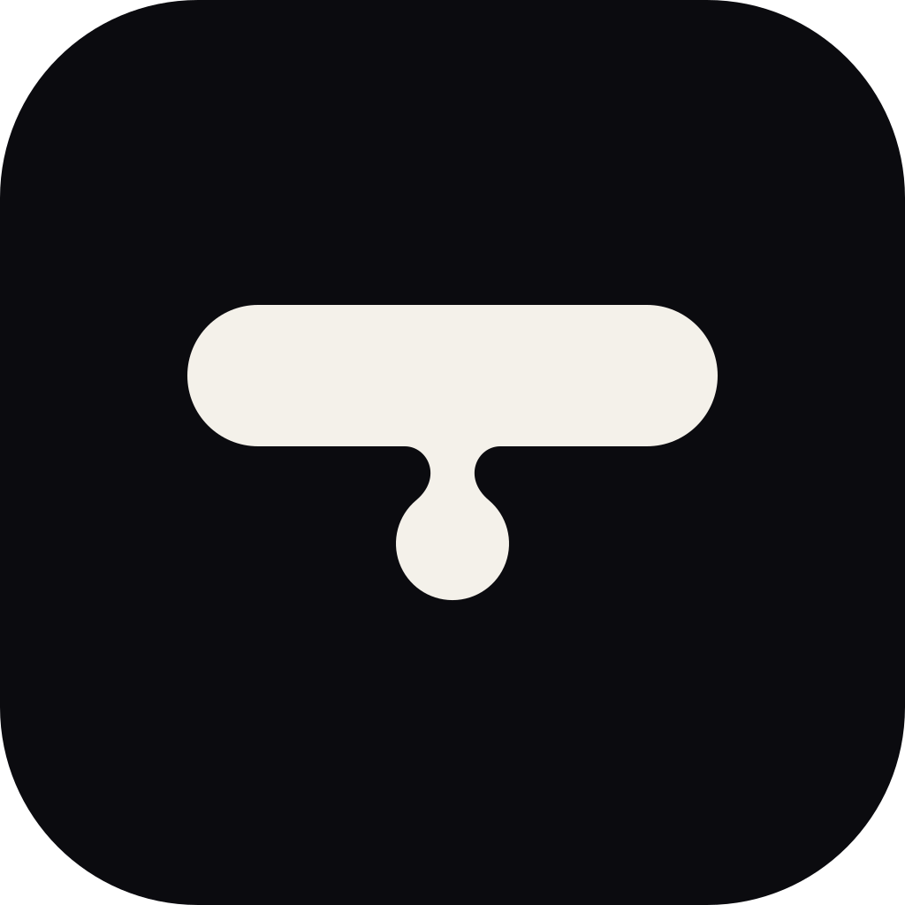
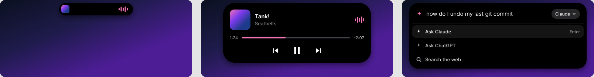

  
  <h1>Sumi</h1>
  
Une île gratuite et open source en haut de votre écran Windows.

  

    
    
    
    
  

  
<a href="README.md">English</a> · <b>Français</b>

> [!NOTE]
> Sumi est en début de développement. Il n'y a encore rien à installer, et les images ci-dessus sont des maquettes. Suivez le dépôt (Watch → Custom → Releases) pour être prévenu de la première version.

Sumi affiche une petite pilule noire en haut de l'écran. Elle donne l'heure, puis change quand il se passe quelque chose : une chanson démarre, une app allume votre micro, un minuteur se termine. Un clic dessus affiche les commandes.

## Prévu pour la 1.0

- La musique de toute app que Windows sait piloter (Spotify, navigateurs, VLC…) : pochette, lecture/pause, progression.
- Un point orange ou vert quand une app utilise le micro ou la caméra.
- Une barre de commande (`Ctrl+Alt+Espace`) qui envoie votre question à Claude, ChatGPT, Gemini, Perplexity ou à un moteur de recherche.
- Des minuteurs : tapez `25m`.
- La météo d'[Open-Meteo](https://open-meteo.com), et sur portable des alertes de charge et de batterie faible.
- Elle se masque quand un jeu ou une vidéo est en plein écran.

Notifications, Bluetooth, agenda, historique du presse-papiers et statut de Claude Code arrivent après la 1.0.

## Gratuit et privé

Pas de compte, pas de version payante, pas de télémétrie. Tout tourne sur votre PC. Les seules requêtes réseau sont celles que vous activez : météo, agenda et mises à jour.

## Contribuer

Le code arrive d'abord sur la branche `dev`. Lisez [CONTRIBUTING.md](CONTRIBUTING.md) avant d'ouvrir une pull request, et [docs/design.md](docs/design.md) pour le comportement de l'île (en anglais). Idées et retours sont les bienvenus dans les [Discussions](https://github.com/Rateur/sumi/discussions).

## Licence

[MIT](LICENSE). Sumi n'est affilié ni à Apple ni à Microsoft.
