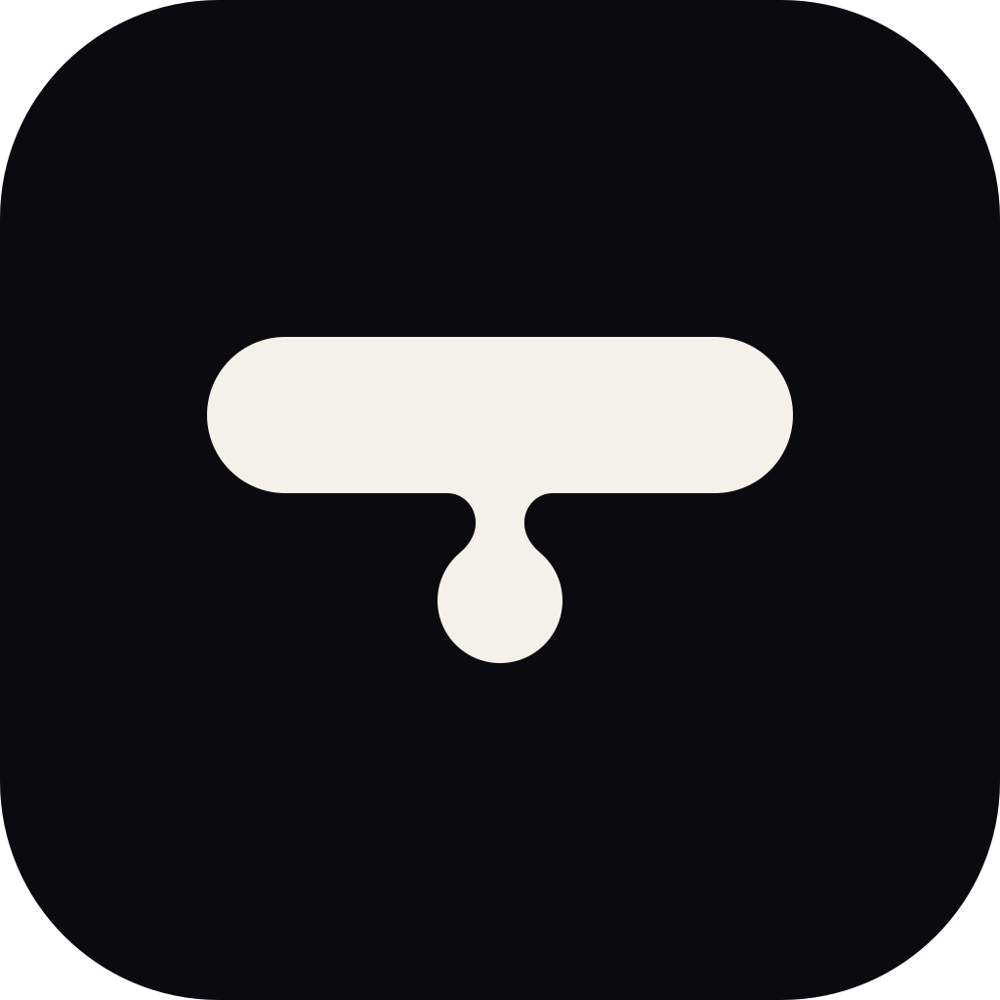

  
  <h1>Sumi</h1>
  
Une île gratuite et open source en haut de votre écran Windows.

  

    
    
    
    
  

  
<a href="README.md">English</a> · <b>Français</b>

Sumi affiche une petite pilule noire en haut de l'écran. Elle donne l'heure, puis change quand il se passe quelque chose : une chanson démarre, une app allume votre micro, un minuteur se termine. Un clic dessus affiche les commandes.

> [!NOTE]
> Sumi est en début de développement. La version 0.8.0 affiche l'heure, ajoute la date quand le curseur se pose dessus, s'ouvre en panneau au clic, se masque quand un jeu ou une vidéo est en plein écran, affiche votre musique avec ses commandes, met un point à côté de l'île quand une app utilise votre micro ou votre caméra, ouvre une barre de commande pour un minuteur, une app, la météo ou une question, se range en un trait en haut quand vous la balayez ou la laissez au repos, et donne la batterie de votre PC et de vos appareils, même celle que Windows ne montre pas. Suivez le dépôt (Watch → Custom → Releases) pour être prévenu des nouvelles versions.

## Télécharger

[**Télécharger Sumi pour Windows**](https://github.com/Rateur/sumi/releases/latest/download/Sumi-setup.exe) (10 et 11, 64 bits), ou choisissez une version sur la [page des releases](https://github.com/Rateur/sumi/releases).

L'installateur n'est pas encore signé. Votre navigateur peut le retenir comme peu téléchargé : conservez-le depuis sa liste de téléchargements. Windows signale ensuite un éditeur inconnu : cliquez sur **Informations complémentaires**, puis **Exécuter quand même**. Une version Microsoft Store, signée par Microsoft, arrive : voir la [politique de signature du code](https://sumi.rateur.fr/fr/docs/code-signing/). Pour quitter Sumi, passez par son icône dans la zone de notification.

## Feuille de route

Chaque étape sort dans sa propre version. La 1.0 sera prête quand toutes les cases seront cochées.

- [x] L'île en haut de l'écran, avec l'heure (0.1.0)
- [x] Les animations à ressort : posez le curseur sur l'île et elle s'élargit, cliquez et elle s'ouvre (0.2.0)
- [x] Elle se masque quand un jeu ou une vidéo est en plein écran (0.3.0)
- [x] La musique de toute app que Windows sait piloter (Spotify, navigateurs, VLC…) : pochette, précédent, lecture/pause, suivant, progression ; l'heure passe dans une bulle à côté (0.4.0)
- [x] Un point orange ou vert quand une app utilise le micro ou la caméra, avec l'app et un bouton muet sous le curseur (0.5.0)
- [x] Une barre de commande (`Win+Alt+S`) : un minuteur, une app, une question pour Claude, ChatGPT, Gemini, Perplexity ou un moteur de recherche ; des minuteurs sur l'île, dès `25m` (0.6.0)
- [x] Ranger l'île en un fin trait en haut d'un balayage, ou seule au repos ; une icône vivante dans la zone de notification, avec le micro, la caméra et la musique, qui la range ou la fait revenir (0.7.0)
- [x] La météo depuis la barre de commande, via [Open-Meteo](https://open-meteo.com) ; les batteries du PC et de ses appareils Bluetooth, y compris celles que Windows n'affiche pas, avec un coup d'œil quand vous branchez le PC, quand sa batterie faiblit ou qu'un appareil se connecte (0.8.0)
- [ ] Presse-papiers et capture : l’historique du presse-papiers dans la barre de commande (`Win+Alt+V`), chaque élément collé là où vous étiez, avec son action. Une capture (`Win+Alt+C`) copie depuis l’écran une couleur, un texte ou un QR code.
- [ ] Les réglages (écran, thème, langue, raccourcis), les mises à jour automatiques et le Microsoft Store

## Comment c'est fait

  
  
  
  
  

Sumi est une app [Tauri 2](https://v2.tauri.app). Un cœur en Rust dialogue avec Windows : il place la fenêtre, laisse passer les clics, lit l'état des médias, du micro, de la caméra et des batteries. Une interface en [Svelte 5](https://svelte.dev) et TypeScript dessine l'île dans WebView2, le moteur de navigateur déjà intégré à Windows : Sumi n'embarque donc pas son propre navigateur, et l'installateur reste léger.

## Confidentialité

Sumi ne collecte rien. Sa seule requête réseau est la météo, et seulement après votre accord dans la barre de commande. À chaque demande, [Open-Meteo](https://open-meteo.com) reçoit la ville tapée et votre adresse IP, qu'il garde dans ses journaux jusqu'à 90 jours ([conditions](https://open-meteo.com/en/terms)). Votre oui et la dernière ville demandée restent sur ce PC, chiffrés pour votre compte Windows, jusqu'à ce que vous choisissiez **Oublier la météo** dans le menu de l'icône de Sumi. L'historique du presse-papiers, une fois autorisé, reste sur ce PC, chiffré pour votre compte Windows, et n'est envoyé nulle part. L'écran figé d'une capture reste en mémoire et disparaît dès qu'elle se termine, et son texte est lu sur ce PC par Windows.

## Contribuer

Le code arrive d'abord sur la branche `dev`. Lisez [le guide de contribution](https://sumi.rateur.fr/fr/docs/contribute/) avant d'ouvrir une pull request : il liste ce que vérifie une relecture, du nommage à la doc dans les deux langues. [Fonctionnement de l'île](https://sumi.rateur.fr/fr/docs/design/) décrit le comportement de l'île, et les agents de code commencent par [AGENTS.md](AGENTS.md) (en anglais). Questions et retours sont les bienvenus dans les [Discussions](https://github.com/Rateur/sumi/discussions).

## Licence

[MIT](LICENSE). Données météo d'[Open-Meteo](https://open-meteo.com), sous licence [CC BY 4.0](https://creativecommons.org/licenses/by/4.0/deed.fr).
