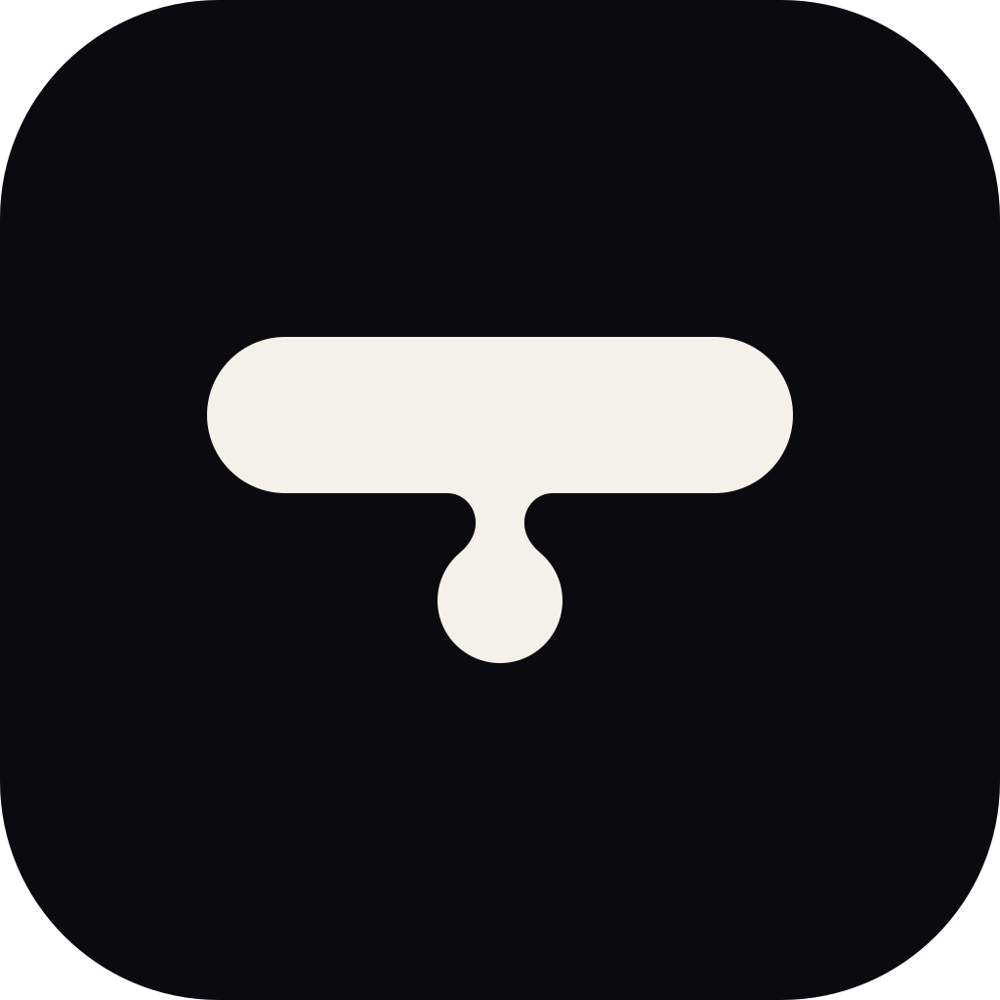

  
  <h1>Sumi</h1>
  
A free, open-source island for the top of your Windows screen.

  

    
    
    
    
  

  
<b>English</b> · <a href="README.fr.md">Français</a>

Sumi puts a small black pill at the top of your screen. It shows the time, then changes when something happens: a song starts, an app turns on your microphone, a timer runs out. Click it for controls.

> [!NOTE]
> Sumi is in early development. Version 0.8.0 shows the time, adds the date when you rest the cursor on it, opens into a panel when you click it, hides while a game or video is fullscreen, shows your music with its controls, puts a dot beside the island while an app uses your microphone or camera, opens a command bar for a timer, an app, the weather or a question, tucks into a line at the top when you swipe it away or leave it at rest, and shows the batteries of your PC and your devices, even ones Windows doesn't show. Watch the repository (Custom → Releases) to hear about new versions.

## Download

[**Download Sumi for Windows**](https://github.com/Rateur/sumi/releases/latest/download/Sumi-setup.exe) (10 and 11, 64-bit), or pick a version on the [releases page](https://github.com/Rateur/sumi/releases).

The installer isn't signed yet. Your browser may hold it as rarely downloaded: keep it from its downloads list. Windows then warns about an unknown publisher: click **More info**, then **Run anyway**. A Microsoft Store version, signed by Microsoft, is on its way: see the [code signing policy](https://sumi.rateur.fr/docs/code-signing/). Quit Sumi from its tray icon.

## Roadmap

Each step ships as its own version. Version 1.0 is done when every box is checked.

- [x] The island at the top of the screen, with the time (0.1.0)
- [x] Spring animations: rest the cursor on the island and it widens, click it and it opens (0.2.0)
- [x] Hides itself while a game or video is fullscreen (0.3.0)
- [x] Music from any app Windows can control (Spotify, browsers, VLC…): artwork, previous, play/pause, next, progress; the time moves to a bubble beside it (0.4.0)
- [x] An orange or green dot when an app uses your microphone or camera, with the app and a mute under the cursor (0.5.0)
- [x] A command bar (`Win+Alt+S`): a timer, an app, a question for Claude, ChatGPT, Gemini, Perplexity or a search engine; timers on the island, from `25m` (0.6.0)
- [x] Tuck the island into a thin line at the top with a swipe, or by itself at rest; a live tray icon with the microphone, camera and music that tucks it or brings it back (0.7.0)
- [x] The weather from the command bar, through [Open-Meteo](https://open-meteo.com); the batteries of the PC and its Bluetooth devices, including ones Windows doesn't show, with a peek as you plug in, run low or connect one (0.8.0)
- [ ] Clipboard and capture: your clipboard history in the command bar (`Win+Alt+V`), each item pasted where you were, with its action. A capture (`Win+Alt+C`) copies a color, text or a QR code from the screen.
- [ ] Settings (screen, theme, language, shortcuts), automatic updates and the Microsoft Store

## How it's built

  
  
  
  
  

Sumi is a [Tauri 2](https://v2.tauri.app) app. A Rust core talks to Windows: it places the window, lets clicks through, reads media, microphone/camera state and batteries. A [Svelte 5](https://svelte.dev) and TypeScript interface draws the island inside WebView2, the browser engine already built into Windows, so Sumi doesn't ship a browser of its own and the installer stays small.

## Privacy

Sumi collects nothing. Its only network request is the weather, and only after you allow it in the command bar, once per session: [Open-Meteo](https://open-meteo.com) then gets the city you typed and your IP address, which it keeps in its logs for up to 90 days ([terms](https://open-meteo.com/en/terms)). Your yes and the city stay in memory until Sumi quits. The clipboard history, once you allow it, stays on this PC, encrypted for your Windows account, and is never sent anywhere. A capture's frozen screen stays in memory and is freed as soon as it ends, and its text is read on this PC by Windows.

## Contributing

Code lands on the `dev` branch first. Read [the contributing guide](.github/CONTRIBUTING.md) before opening a pull request: it lists what a review checks, from naming to the docs in both languages. [docs/design.md](docs/design.md) covers how the island behaves, and coding agents start with [AGENTS.md](AGENTS.md). Questions and feedback are welcome in [Discussions](https://github.com/Rateur/sumi/discussions).

## License

[MIT](LICENSE). Weather data by [Open-Meteo](https://open-meteo.com), under [CC BY 4.0](https://creativecommons.org/licenses/by/4.0/).
