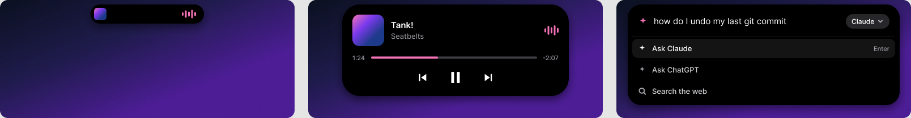

  
  <h1>Sumi</h1>
  
A free, open-source island for the top of your Windows screen.

  

    
    
    
    
  

  
<b>English</b> · <a href="README.fr.md">Français</a>

Sumi puts a small black pill at the top of your screen. It shows the time, then changes when something happens: a song starts, an app turns on your microphone, a timer runs out. Click it for controls.

> [!NOTE]
> Sumi is in early development. Version 0.1.0 shows the time and nothing else yet; the images above are mockups of what's coming. Watch the repository (Custom → Releases) to hear about new versions.

## Download

[**Download Sumi for Windows**](https://github.com/Rateur/sumi/releases/latest/download/Sumi-setup.exe) (10 and 11, 64-bit), or pick a version on the [releases page](https://github.com/Rateur/sumi/releases).

The installer isn't signed yet, so Windows warns about an unknown publisher: click **More info**, then **Run anyway**. Quit Sumi from its tray icon.

## Roadmap

Each step ships as its own version. Version 1.0 is done when every box is checked.

- [x] The island at the top of the screen, with the time (0.1.0)
- [ ] Spring animations: the island grows when something happens
- [ ] Music from any app Windows can control (Spotify, browsers, VLC…): artwork, play/pause, progress
- [ ] An orange or green dot when an app uses your microphone or camera
- [ ] A command bar (`Ctrl+Alt+Space`) that sends your question to Claude, ChatGPT, Gemini, Perplexity or a search engine
- [ ] Timers: type `25m`
- [ ] Weather from [Open-Meteo](https://open-meteo.com), charging and low-battery alerts on laptops
- [ ] Hides itself while a game or video is fullscreen
- [ ] Settings, automatic updates and a signed installer

## How it's built

  
  
  
  
  

Sumi is a [Tauri 2](https://v2.tauri.app) app. A Rust core talks to Windows: it places the window, lets clicks through, and will read media, microphone and battery state. A [Svelte 5](https://svelte.dev) and TypeScript interface draws the island inside WebView2, the browser engine already built into Windows, so Sumi doesn't ship a browser of its own and the installer stays small.

## Privacy

Sumi collects nothing. Features that need the network will stay off until you turn them on.

## Contributing

Code lands on the `dev` branch first. Read [the contributing guide](.github/CONTRIBUTING.md) before opening a pull request, and [docs/design.md](docs/design.md) for how the island behaves. Ideas and feedback are welcome in [Discussions](https://github.com/Rateur/sumi/discussions).

## License

[MIT](LICENSE).
